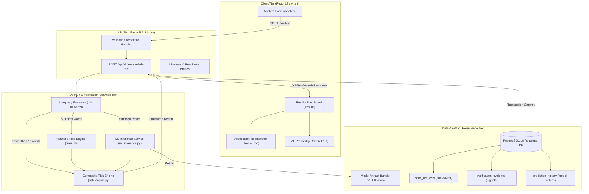
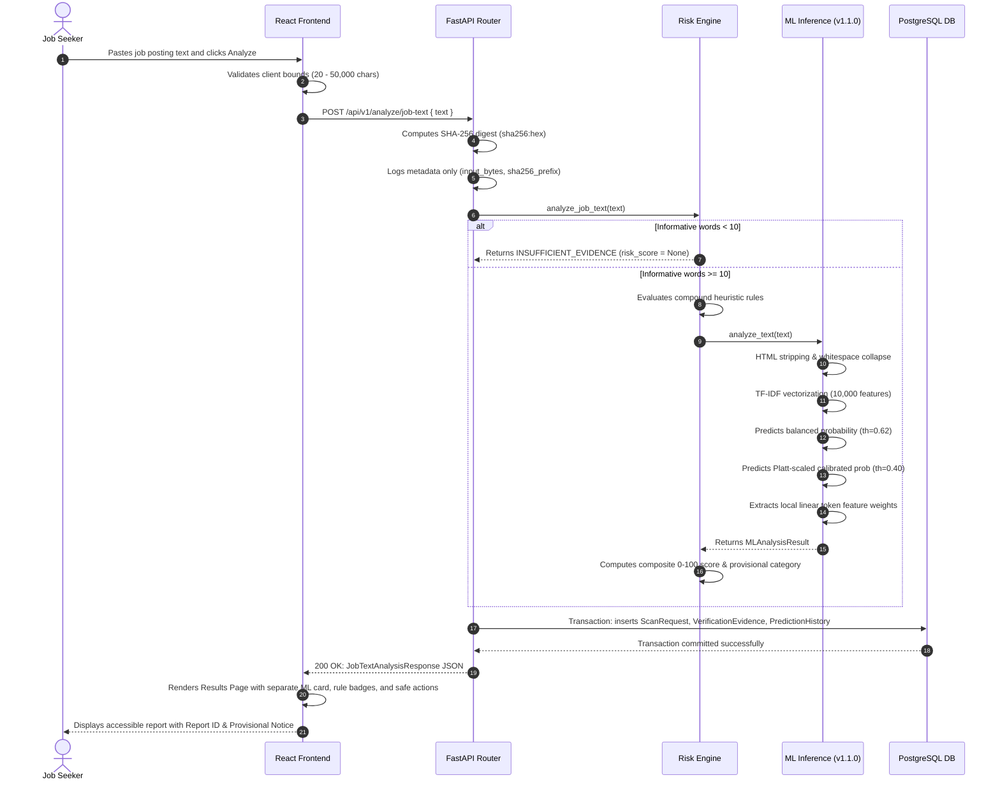

# JobShield AI System Architecture

> **Document Version:** 1.1.0  
> **Status:** Phase 1 (MVP) Implemented & Verified  
> **Authoritative Specification Reference:** `PROJECT_SPECIFICATION.md` (Sections 1, 4, 6, 8, 10, 14, and 16)

---

## 1. Executive Summary & Design Principles

**JobShield AI** is an explainable, multi-signal verification platform designed to protect candidates from recruitment fraud, deceptive job vacancies, advance fee demands, credential phishing, and corporate entity impersonation.

### Core Architectural Principles
1. **Multi-Signal Evidence Separation:** Machine learning linguistic findings and deterministic rule heuristics are maintained as distinct evidence types. Statistical text similarity is never conflated with factual corporate registration.
2. **Strict Probability Calibration:** Posterior fraud probabilities ($P(\text{fraud} \mid \text{text})$) are calibrated using Platt scaling (sigmoid) on validation data without test set leakage. Operational decision thresholds are tuned purely on validation distributions.
3. **Provisional Composite Risk Scoring:** The 0–100 risk score and mapped categories (`LOW`, `MODERATE`, `HIGH`, `CRITICAL`, `INSUFFICIENT_EVIDENCE`) are explicitly marked as provisional heuristics and not statistical probabilities.
4. **Strict Privacy by Design (Zero Raw-Text Storage):** The submitted job posting text is **never** logged to server consoles, never reflected in validation error bodies, and never persisted in raw database columns. Only cryptographic non-reversible digests (`sha256:<hex>`) and derived evidence are stored.
5. **No Single Keyword Decides Outcome:** Heuristic rules enforce multi-token context and negation boundaries to avoid false positives (e.g. standard tuition fee reimbursements or commercial banking roles).
6. **Compliant Risk-Assessment Language:** The system never claims to "prove", declare a listing "is fraud", or assert a listing "is legitimate". All outputs use risk-assessment language.

---

## 2. System Architecture Overview

---

## 3. Component Details (Phase 1)

### 3.1 Frontend Web Client
- **Stack:** React 19, Vite 8, Tailwind CSS v4, Lucide Icons, Recharts.
- **Analyze Form (`frontend/src/pages/Analyze.jsx`):**
  - Textarea with character length counters ($20 \le \text{length} \le 50,000$).
  - One-click sample loaders (suspicious upfront fee listing vs standard engineering vacancy).
  - Handles loading states, validation errors, and 503 outage banners with retry buttons.
- **Results Dashboard (`frontend/src/pages/Results.jsx`):**
  - **Risk Indicator:** Multimodal accessibility with text labels, numeric scores, unique geometric icons, and a prominent provisional notice.
  - **Linguistic Machine Learning Classification Card:** Displays calibrated probability ($P(\text{fraud} \mid \text{text})$), decision threshold ($0.40$), primary screening classification ($0.62$), and explainable TF-IDF feature weights via Recharts.
  - **Evidence List:** Distinguishes Rule-Based Heuristics from ML Findings and Data Quality checks, showing detector names, timestamps, weights, summaries, and caveats.
  - **Insufficient Evidence View:** Null score display with clear diagnostic guidance when text has fewer than 10 informative words.
  - **Safety & Disclaimers:** Actionable defensive checklist for job seekers, technical limitations, and legal disclaimers.

### 3.2 Backend API & Domain Services
- **Framework:** FastAPI with Python 3.12, Pydantic v2 schemas.
- **Rule-Based Engine (`backend/app/services/rules.py`):**
  - Compound regex detectors for upfront fees, sensitive financial/identity credential demands, urgency pressure, unrealistic compensation, suspicious off-platform chat channels (WhatsApp/Telegram), and public webmail recruiter domains.
  - Contextual negation filters (e.g. fee waivers, tuition reimbursement, commercial bank descriptions).
- **ML Inference Service (`backend/app/services/ml_inference.py`):**
  - Loads versioned bundle `jobshield_fraud_detector_v1.1.0.joblib`.
  - Normalizes text without training leakage via `clean_text_for_inference`.
  - Evaluates both the primary balanced Logistic Regression classifier (screening threshold: `0.62`) and the Platt-scaled calibrated Logistic Regression model (operational threshold: `0.40`, ECE: `1.21%`).
  - Strict fail-fast policy: raises `MLInferenceUnavailableError` if the artifact is missing or corrupted; never falls back silently to legacy v1.0.0.
- **Composite Risk Engine (`backend/app/services/risk_engine.py`):**
  - Calculates $S_{\text{composite}} = w_{\text{ML}} \cdot S_{\text{ML}} + w_{\text{rules}} \cdot S_{\text{rules}}$ (configurable weights: 55% ML, 45% rules).
  - Escalation floors for high-severity combinations (e.g. upfront fee + WhatsApp chat).
  - Evaluates input adequacy (fewer than 10 informative words $\implies$ `INSUFFICIENT_EVIDENCE`, `score=None`).

### 3.3 Database Tier & Schema
- **Database Engine:** PostgreSQL 18 (psycopg driver); temporary SQLite used for test isolation.
- **ORM & Migrations:** SQLAlchemy 2.0 with Alembic.
- **Core Relational Schema:**
  - `scan_requests`: Primary scan metadata. `input_reference` stores non-reversible `sha256:<64_hex_digits>`.
  - `verification_evidence`: Individual evidence rows linked via foreign key `scan_id` with `ondelete="CASCADE"`. Stores `evidence_type`, `source_name`, `status`, `confidence`, `summary`, and structured JSON metadata.
  - `prediction_history`: Historical ML records linked via foreign key `scan_id` with `ondelete="CASCADE"`. Stores `model_version`, `model_probability`, `risk_score`, `risk_category`, `threshold_version`, and feature explanations.
  - `model_versions`: Registry of deployed model metadata, training configurations, and evaluation metrics.
  - `dataset_imports`: Audit trail of dataset imports, checksums, and record counts.

---

## 4. End-to-End Data Flow

---

## 5. Privacy, Security & Resilience Architecture

### 5.1 Privacy Protections (Zero Raw-Text Storage)
1. **Request Logs:** `analyze.py` only logs `input_bytes` and `sha256[:12]`. Raw input text is never emitted to console logs.
2. **Validation Sanitization:** A custom `RequestValidationError` handler in `main.py` strips user input from Pydantic 422 error response dictionaries, replacing it with `[REDACTED: len=N]`.
3. **Database Storage:** The database stores `input_reference = f"sha256:{text_sha256}"`. Raw submitted text is never written to database tables.
4. **Exception Handling:** Exception handlers log generic exception names (`type(exc).__name__`) and report UUIDs, never echoing payload contents or database connection credentials.

### 5.2 System Resilience & Error Handling
1. **Missing or Corrupt Model Artifacts:**
   If the v1.1.0 model bundle is missing or invalid, `MLInferenceService` fails fast and the API returns **`HTTP 503 Service Unavailable`**. It will **never** silently fall back to legacy uncalibrated v1.0.0 artifacts or return a deceptively partial rule-only result.
2. **Database Persistence Failures:**
   If database connectivity is lost or a commit fails, the transaction rolls back cleanly, and the API returns **`HTTP 503 Service Unavailable`**. An unpersisted `report_id` is never returned.
3. **Readiness Probe (`/api/v1/health/ready`):**
   Verifies both database responsiveness (`SELECT 1`) and ML model availability (`ml_service.is_available()`), returning `503` if either required component is unhealthy.

---

## 6. Specification Acceptance Matrix (Phase 1 / Section 16)

| Acceptance Criteria Category | Specification Requirement | Verification Status | Test Suite File |
| :--- | :--- | :--- | :--- |
| **Input Validation** | Rejects empty, whitespace-only, non-string, and oversized input ($> 50,000$ chars). | **VERIFIED** | [`tests/test_input_validation.py`](file:///d:/JobShield-AI/tests/test_input_validation.py) |
| **Input Boundaries** | Enforces exact character boundaries ($19$ chars rejected, $20$ chars accepted, $50,000$ chars accepted, $50,001$ chars rejected). | **VERIFIED** | [`tests/test_input_validation.py`](file:///d:/JobShield-AI/tests/test_input_validation.py) |
| **Privacy Redaction** | Validation errors redact raw inputs to prevent credential/data leakage. | **VERIFIED** | [`tests/test_input_validation.py`](file:///d:/JobShield-AI/tests/test_input_validation.py) |
| **ML Bundle Loading** | Loads versioned bundle v1.1.0 with vectorizer, primary LR, and calibrated LR. | **VERIFIED** | [`tests/test_ml_pipeline_loading.py`](file:///d:/JobShield-AI/tests/test_ml_pipeline_loading.py) |
| **Preprocessing Parity** | Preprocessing in inference strictly matches training pipeline (HTML tag removal, whitespace collapsing). | **VERIFIED** | [`tests/test_ml_pipeline_loading.py`](file:///d:/JobShield-AI/tests/test_ml_pipeline_loading.py) |
| **Model Thresholds** | Primary screening threshold ($0.62$) and calibrated operational threshold ($0.40$) are separated and documented. | **VERIFIED** | [`tests/test_ml_pipeline_loading.py`](file:///d:/JobShield-AI/tests/test_ml_pipeline_loading.py) |
| **No Silent Fallback** | Missing or corrupted artifacts raise 503; legacy v1.0.0 is never loaded as fallback. | **VERIFIED** | [`tests/test_ml_pipeline_loading.py`](file:///d:/JobShield-AI/tests/test_ml_pipeline_loading.py) |
| **API Contract** | All Section 4 fields present with exact data types; separate ML probability from composite score. | **VERIFIED** | [`tests/test_api_contract.py`](file:///d:/JobShield-AI/tests/test_api_contract.py) |
| **Insufficient Evidence** | Scant text ($< 10$ words) returns `INSUFFICIENT_EVIDENCE`, `score=None`, and omits ML execution. | **VERIFIED** | [`tests/test_api_contract.py`](file:///d:/JobShield-AI/tests/test_api_contract.py) |
| **DB Persistence** | Safely persists `ScanRequest`, `VerificationEvidence`, and `PredictionHistory` with relational foreign keys. | **VERIFIED** | [`tests/test_db_persistence.py`](file:///d:/JobShield-AI/tests/test_db_persistence.py) |
| **DB Cascade & Rollback** | Cascade deletion cleans child records; transaction rollbacks prevent ghost records. | **VERIFIED** | [`tests/test_db_persistence.py`](file:///d:/JobShield-AI/tests/test_db_persistence.py) |
| **Zero Raw-Text DB** | The raw submitted text is never stored in DB records; `input_reference` stores SHA-256 digest. | **VERIFIED** | [`tests/test_analyze_job_text.py`](file:///d:/JobShield-AI/tests/test_analyze_job_text.py) |
| **No Single Keyword Rule** | Contextual regex guards prevent single keywords (like "bank" or "fee") from deciding outcomes. | **VERIFIED** | [`tests/test_analyze_job_text.py`](file:///d:/JobShield-AI/tests/test_analyze_job_text.py) |
| **Health & Readiness** | Liveness probe (`200`) and readiness probe (`200`/`503`) protect against secrets leakage. | **VERIFIED** | [`tests/test_health.py`](file:///d:/JobShield-AI/tests/test_health.py) |
