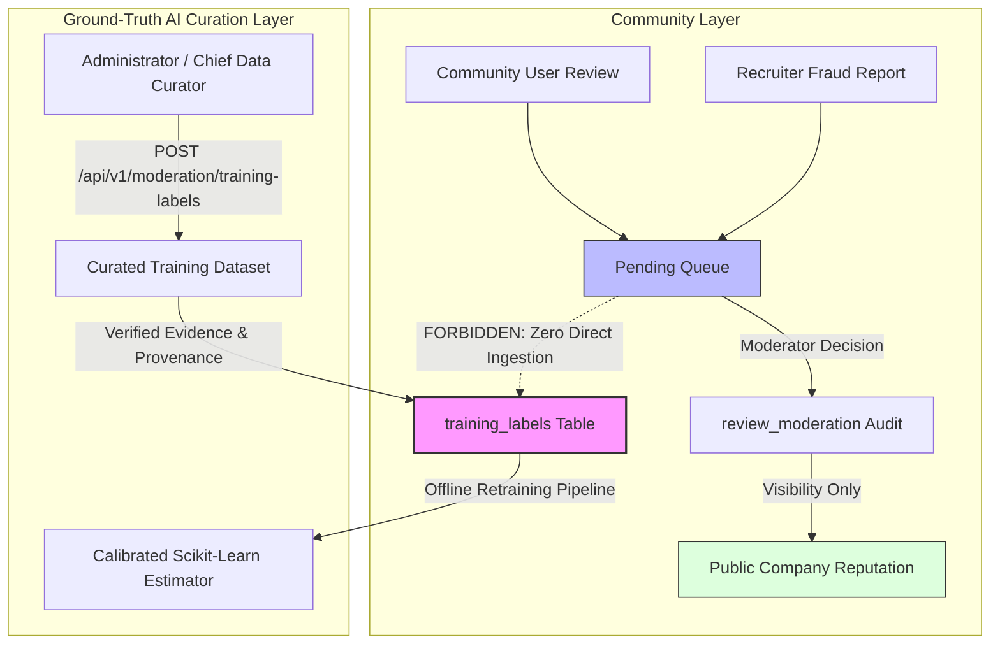

# JobShield AI — Authentication, RBAC, Moderation, Audit Trail & Governance Architecture

This document specifies the technical design, security controls, cryptographic invariants, and operational procedures for JobShield AI's Authentication, Role-Based Access Control (RBAC), Community Moderation Queue, Appeals Workflow, Scan History, and Administrator Controls.

---

## 1. Threat Model & Security Posture

JobShield AI verifies recruitment communications and safeguards job seekers against fraudulent solicitations. Because malicious threat actors may attempt to manipulate reputation ratings, compromise user accounts, or poison the machine learning training pipeline, the platform adheres to strict zero-trust and defense-in-depth principles:

1. **Deny-by-Default RBAC:** All sensitive endpoints require explicit role entitlement (`require_roles`). Missing or invalid tokens yield `401 Unauthorized`; insufficient roles yield `403 Forbidden`.
2. **Zero-Knowledge Credential Storage:** Passwords are never stored in plaintext or reversible encryption; only salted, memory-hard Argon2id hashes are retained.
3. **Token Rotation & Replay Attack Defense:** Refresh tokens are single-use. When a refresh token is presented, it is rotated. If a previously consumed or revoked token is reused, all active user sessions are immediately revoked.
4. **Append-Only Immutable Audit Trail:** All security-sensitive operations (logins, logouts, role changes, suspensions, moderation decisions, appeals, scan deletions) are permanently written to `security_audit_logs` and `review_moderation`. Zero application-level edit (`UPDATE`) or delete (`DELETE`) operations exist.
5. **Mandatory Training Label Isolation:** Community reviews, fraud reports, moderation approvals, and appeal outcomes **NEVER** alter, create, or influence ML training datasets or ground-truth labels (`training_labels`).

---

## 2. Authentication Architecture

### 2.1 Password Hashing & Validation
- **Algorithm:** Argon2id via `argon2-cffi` (recommended by OWASP with memory cost $t=3, m=65536, p=4$).
- **Password Complexity Rules:**
  - Minimum 8 characters
  - At least 1 uppercase letter (`[A-Z]`)
  - At least 1 lowercase letter (`[a-z]`)
  - At least 1 numeric digit (`[0-9]`)
- **Login Invariant:** Unsuccessful login attempts return a uniform error message (`"Invalid email or password."`) to eliminate user enumeration risks.
- **Rate Limiting:** Login attempts are bounded by an in-memory sliding window rate limiter (max 5 failed attempts per 60 seconds per IP/email) to prevent credential stuffing.

### 2.2 Token Lifecycle
- **Access Tokens:** Short-lived JSON Web Tokens (15-minute expiration) signed with HMAC-SHA256 containing `sub` (user UUID), `role`, and `exp`.
- **Refresh Tokens:** Long-lived cryptographically secure random tokens (32 bytes, hex-encoded, 7-day expiration).
  - **Storage:** Only the SHA-256 digest of the refresh token is stored in the database (`refresh_tokens.token_hash`), preventing token exposure in the event of database exfiltration.
  - **Single-Use Rotation:** Issuing a new access token invalidates the used refresh token and mints a replacement.
  - **Replay Attack / Reuse Detection:** If an incoming refresh token's hash matches an already-revoked token, all active sessions for that `user_id` are instantaneously marked revoked (`is_revoked = True`).
- **Transport Security:** Access and refresh tokens are delivered both in the JSON payload (for mobile/API clients) and in `HttpOnly`, `SameSite=Lax`, `Secure` cookies (for web browser clients).

---

## 3. Role-Based Access Control (RBAC)

JobShield AI defines four hierarchical roles:

| Role | Description | Allowed Actions |
| :--- | :--- | :--- |
| `VISITOR` | Unauthenticated public visitor | Submit anonymous scans (text, URL, email, offer letter); view public results preview; view public company reputation; submit community reviews/reports (with client IP rate-limiting). |
| `USER` | Authenticated community member | All VISITOR capabilities + maintain personal scan history (`/my-scans`); delete personal scans; submit moderation appeals on own reviews/reports; manage account profile and credentials. |
| `MODERATOR` | Vetted platform moderator | All USER capabilities + access persistent moderation queue (`/moderation/queue`); review pending reviews & fraud reports; commit atomic moderation decisions (`APPROVED`, `REJECTED`, `FLAGGED`); resolve appeals (`UPHELD`, `DISMISSED`); view moderation audit trail. |
| `ADMIN` | System administrator | All MODERATOR capabilities + list all registered accounts (`/admin/users`); promote/demote user roles; activate or suspend accounts (with immediate session revocation); inspect system-wide append-only security audit log (`/admin/audit-logs`); curate verified ground-truth training labels (`/moderation/training-labels`). |

---

## 4. Persistent Moderation Queue & Appeals

### 4.1 Moderation Decisions
1. **Queue Ingestion:** New community reviews and recruiter reports enter in `PENDING` state with sensitive submitter identifiers masked (`mask_email`, deterministic HMAC submitter hashing).
2. **Atomic Commit Transaction:** When a moderator reviews an item, a single database transaction:
   - Updates the item's `moderation_status` to `APPROVED`, `REJECTED`, or `FLAGGED`.
   - Inserts an append-only audit entry into `review_moderation`.
   - Inserts a security audit record into `security_audit_logs`.
   - Refreshes company Bayesian reputation stats if the item is a review.

### 4.2 Appeals Workflow
- Authenticated users whose reviews or fraud reports have been rejected or moderated can file a `ModerationAppeal` stating their evidentiary justification.
- Moderators or admins review appeals in the moderation portal:
  - **`UPHELD`:** Restores the item to `APPROVED` and updates the appeal resolution status to `UPHELD`.
  - **`DISMISSED`:** Affirms the rejection and marks the appeal `DISMISSED`.
- All appeal actions record reviewer notes and commit an append-only audit trail entry.

---

## 5. Machine Learning Training-Data Isolation Invariant

> [!IMPORTANT]
> Under no circumstances do community submissions, moderator decisions, or appeal resolutions directly update or create records in `training_labels`. Training label curation is strictly confined to authenticated administrators with verified evidence provenance to prevent adversarial poisoning attacks.

---

## 6. Scan History & IDOR Protections

1. **Anonymous Support:** Public visitors can run full scans without authentication. Anonymously submitted scans remain accessible via public scan ID lookup.
2. **Authenticated Association:** If an authenticated user runs a scan (via Bearer token or cookie), the scan request is linked to their `user_id`.
3. **IDOR Defense:**
   - Private scans and their corresponding PDF reports (`GET /api/v1/scans/{scan_id}/report.pdf`) can only be accessed by the owning user or platform administrators.
   - Unauthorized attempts by other users yield `403 Forbidden`.
   - Users can list (`GET /api/v1/scans/my-scans`) and delete (`DELETE /api/v1/scans/{scan_id}`) their own records from personal history.

---

## 7. Database Migration & Schema

Alembic migration `0008_auth_rbac_audit_and_appeals.py` establishes the following tables:
- `users`: User profiles, Argon2id password hash, role (`VISITOR`, `USER`, `MODERATOR`, `ADMIN`), active status, verification status, timestamps.
- `refresh_tokens`: Cryptographic SHA-256 token hash, user reference, expiration, revocation state, creation metadata.
- `moderation_appeals`: Submitter reference, target item type (`review`, `report`), target UUID, appeal reason, resolution status (`PENDING`, `UPHELD`, `DISMISSED`), resolver user ID, resolution notes.
- `security_audit_logs`: Immutable append-only audit table with UUID primary key, timestamp, actor `user_id`, action verb, target type, target ID, and JSONB `details`.

Migration is completely reversible (`alembic downgrade -1`).
