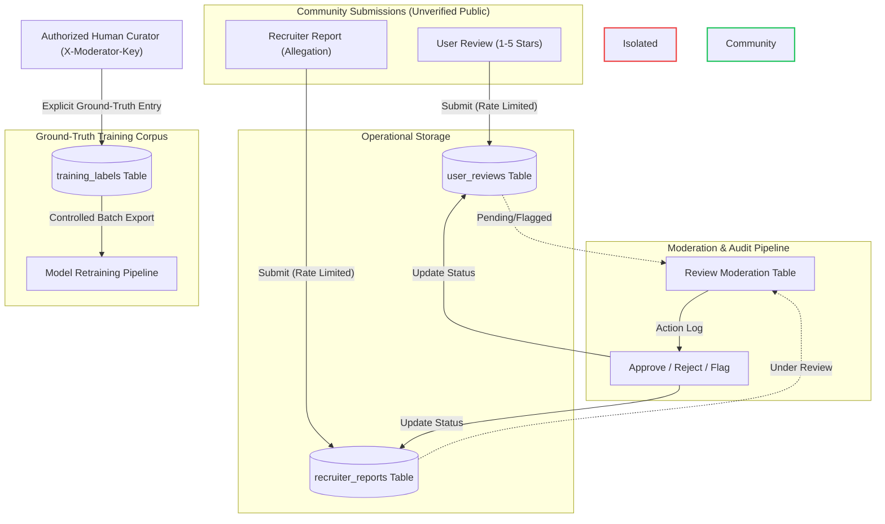

# Community Feedback, Moderation & Company Reputation (Features F8 & F9)

This document details the architectural design, mathematical foundations, data protection safeguards, and workflow isolation governing community feedback, moderation, and company reputation in JobShield AI.

---

## 1. Architectural Principles & Mandates

Features F8 and F9 satisfy strict design constraints defined in `PROJECT_SPECIFICATION.md` (Sections 5, 8, 9, 10, 11):

1. **Strict Separation of Concerns**:
   - **Service Quality Reviews (F9)**: 1–5 star subjective ratings of recruitment communication, interview processes, role clarity, and offer transparency.
   - **Fraud Allegations (F8)**: Factual allegations of upfront payment demands, fake job offers, impersonation, or phishing.
   - **Rule**: Fraud reports are investigated separately and are **NEVER** converted into stars, subtracted from ratings, or used directly to generate fraud probability scores.
2. **Bayesian Reputation Adjustment**:
   - Mitigates small-sample instability using platform-wide prior beliefs.
   - Prevents a single rogue 1-star or 5-star review from distorting an employer's reputation.
3. **Training Data Isolation (Critical Safety Guarantee)**:
   - Community reviews and fraud reports **NEVER** automatically create, modify, or promote records in the `training_labels` table.
   - Only explicitly authorized human curators with verified administrative credentials can create ground-truth training labels.
4. **Privacy-by-Design**:
   - Submitter client IP addresses are **NEVER** stored in plaintext. They are salted and cryptographically hashed (`submitter_hash = SHA256(salt + IP)`).
   - Recruiter email addresses are masked (`r***n@domain.com`) in public query results.
   - Pre-submission prompts and validation reject sensitive personal credentials (passwords, OTPs, CVVs, bank account numbers).

---

## 2. Bayesian Reputation Mathematics

### Mathematical Formulation
The platform computes the damped Bayesian reputation $R$ from eligible approved reviews:

$$R = \left( \frac{n}{n + m} \right) \bar{r} + \left( \frac{m}{n + m} \right) C$$

Where:
- $n$: Number of eligible approved, non-duplicate reviews.
- $\bar{r}$: Arithmetic mean of eligible reviews, $\bar{r} = \frac{1}{n} \sum_{i=1}^n r_i$.
- $m$: Prior strength parameter ($m > 0$), configured via `REPUTATION_PRIOR_STRENGTH_M` (default: `5.0`).
- $C$: Prior platform mean rating ($C \in [1.0, 5.0]$), configured via `REPUTATION_PRIOR_MEAN_C` (default: `3.5`).

### Boundary & Damping Behaviors
- **Zero Submissions ($n = 0$)**:
  $$R = C = 3.5, \quad \bar{r} = \text{None}, \quad \text{Confidence} = 0.0$$
- **Small Volume ($n = 1$, rating = 5)**:
  $$R = \left(\frac{1}{6}\right) \times 5.0 + \left(\frac{5}{6}\right) \times 3.5 = \frac{5.0 + 17.5}{6} = 3.75$$
  *Notice that a single 5-star review does not propel the entity to 5.0; it is conservatively pulled toward the prior 3.5.*
- **Large Volume ($n \to \infty$)**:
  $$\lim_{n \to \infty} R = \bar{r}, \quad \lim_{n \to \infty} \text{Confidence} = 1.0$$

### Coverage Confidence Indicator
The heuristic confidence indicator represents empirical coverage versus prior uncertainty:

$$\text{Confidence} = \frac{n}{n + m} \in [0.0, 1.0)$$

This score is presented to users as a coverage percentage (e.g. $2 / (2 + 5) \approx 29\%$) to convey how much weight comes from actual community feedback versus the conservative prior.

---

## 3. Training Data Isolation Architecture

> [!CAUTION]
> **Zero Automated Pipeline Trigger**: No webhook, database trigger, or background worker can promote a community review or recruiter report into `training_labels`. Training labels require explicit manual verification by an authorized curator with cryptographic provenance notes.

---

## 4. Abuse Prevention & Security

| Safeguard | Implementation | Threshold / Specification |
| :--- | :--- | :--- |
| **Rate Limiting** | In-memory sliding-window limiter | Max 5 requests per 60s window per submitter hash |
| **Burst Throttling** | Sub-window rate limiter | Max 3 requests per 10s burst window |
| **Duplicate Detection** | Deterministic SHA-256 content hashing | Canonical string hash comparison; returns HTTP 409 Conflict |
| **Privacy Hashing** | Salted SHA-256 IP hashing | `SHA256(salt + IP)`; raw IP address is discarded immediately |
| **Sensitive Term Screening** | Pydantic regex & keyword validator | Rejects passwords, OTPs, CVVs, and account numbers with HTTP 422 |

---

## 5. API Reference

### 1. `POST /api/v1/reviews`
Submits a 1–5 star recruitment service experience review.
- **Request Body**: `UserReviewCreate` (`company_id`, `company_name`, `rating`, `category`, `review_text`).
- **Response**: `UserReviewResponse` (`id`, `company_id`, `rating`, `category`, `status`, `created_at`).

### 2. `GET /api/v1/reviews`
Queries approved community reviews filterable by company ID and status.

### 3. `POST /api/v1/reports`
Submits a recruiter fraud report (fake offer, upfront fee, impersonation).
- **Request Body**: `RecruiterReportCreate` (`company_id`, `report_type`, `details`, `evidence_summary`).
- **Response**: `RecruiterReportResponse`.

### 4. `GET /api/v1/companies/{company_id}/reputation`
Retrieves sourced Bayesian company reputation metrics:
- Bayesian score $R$
- Total approved reviews $n$
- Raw mean rating $\bar{r}$
- Rating distribution histogram (1–5 stars)
- **Separate fraud reports count and breakdown by allegation type**

### 5. `POST /api/v1/moderation/decisions`
Applies moderator decisions (`APPROVE`, `REJECT`, `FLAG`). Requires `X-Moderator-Key` header.

### 6. `POST /api/v1/reports/{report_id}/appeal`
Enables submitters to register an appeal against a report decision.

### 7. `POST /api/v1/moderation/training-labels`
Authorized curator endpoint to explicitly register ground-truth training labels. Requires `X-Moderator-Key` header.
