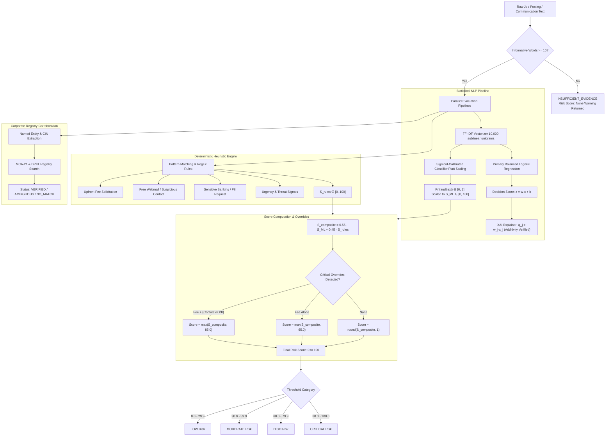

# JobShield AI: Risk-Scoring Methodology & ML Validation Framework

**Document Version:** 1.1.0  
**Status:** Active  
**Scope:** Architecture, Composite Risk Scoring, Model Validation, Platt Calibration, and Explainable AI (XAI)  
**Reference Specification:** `PROJECT_SPECIFICATION.md` Sections 4, 5 (F1, F2, F6), 10, and 12  

---

## 1. Overview & Core Philosophy

JobShield AI evaluates recruitment communications, job postings, recruiter identities, and offer letters to protect job seekers from employment scams, advance-fee extortion, and identity theft. 

The system operates under three strict design principles:

1. **Separation of Statistical Risk and Composite Risk:**  
   The Machine Learning (ML) predicted probability $P(\text{fraud} \mid \text{text})$ is a formal statistical posterior estimated from linguistic features. The Composite Risk Score ($0\text{--}100$) is an operational heuristic blend combining statistical text signals, deterministic rule heuristics, corporate registry corroboration (MCA-21 / DPIIT), and safety overrides. The two quantities are never conflated or substituted for one another.

2. **Strict Registry and Non-Fraud Principles:**  
   A registry search outcome of `NO_MATCH` indicates that an entity could not be confirmed in official MCA or DPIIT databases. `NO_MATCH` is **never** presented as an affirmative fraud signal, nor does it arbitrarily penalize an otherwise benign posting. Conversely, a corporate registry match confirms legal entity existence only—it does not prove recruiter authorization or posting authenticity.

3. **Mathematical and Honest Explainability:**  
   Local feature explanations reflect the actual mathematical mechanics of the underlying estimator (e.g. exact log-odds additivity $\sum \phi_j + b = z$ for linear models). Heuristic rule triggers are strictly isolated and never mislabeled as model feature weights. When an estimator or input cannot be explained mathematically, the system returns an honest "Explanation unavailable" state without fabricating contributions. Feature contributions describe model behavior—they do not establish legal intent, causation, or proof of fraud.

---

## 2. Composite Risk-Scoring Architecture

---

## 3. Empirical Composite Scoring Formulation

The composite risk score $S_{\text{composite}} \in [0, 100]$ operationalizes multi-source fraud signals into an interpretable metric for candidates and moderators.

### 3.1 Aggregation Formula

$$S_{\text{composite}} = w_{\text{ML}} \cdot S_{\text{ML}} + w_{\text{rules}} \cdot S_{\text{rules}}$$

Where:
- $S_{\text{ML}} = 100 \cdot P_{\text{cal}}(\text{fraud} \mid \text{text}) \in [0, 100]$ is the Platt-scaled calibrated probability of recruitment scam patterns expressed on a percentage scale.
- $S_{\text{rules}} \in [0, 100]$ is the cumulative heuristic rule score produced by evaluating regex patterns for advance fees, unauthenticated communication channels, PII requests, and scam urgency markers.
- $w_{\text{ML}} = 0.55$ (Configurable setting: `RISK_SCORE_WEIGHT_ML`).
- $w_{\text{rules}} = 0.45$ (Configurable setting: `RISK_SCORE_WEIGHT_RULES`).
- Constraints: $w_{\text{ML}} + w_{\text{rules}} = 1.0$.

### 3.2 High-Severity Safety Override Floors

Statistical models can occasionally produce lower confidence scores on novel scam templates that use evasive language. To guarantee victim safety when direct fraud patterns are detected, deterministic override floors are applied:

1. **Compound Extortion Floor ($\ge 85.0$):**  
   If an upfront fee solicitation (`Upfront Fees`) is detected concurrently with either an unauthenticated communication channel (`Suspicious Contact`) or a request for sensitive banking/identity details (`Sensitive Information`):
   $$S_{\text{final}} = \max(S_{\text{composite}}, 85.0) \implies \text{CRITICAL category}$$

2. **Direct Fee Solicitation Floor ($\ge 65.0$):**  
   If an upfront fee solicitation is detected without secondary compound indicators:
   $$S_{\text{final}} = \max(S_{\text{composite}}, 65.0) \implies \text{HIGH category}$$

3. **Clamping & Precision:**  
   $$S_{\text{final}} = \text{round}\Big(\min\big(100.0, \max(0.0, S_{\text{composite}})\big), 1\Big)$$

---

## 4. Documented Risk Categories & Provisional Thresholds

Provisional thresholds are established in `backend/app/core/config.py` and returned in every API response payload under `provisional_thresholds`:

| Risk Category | Score Range | Operational Meaning | Recommended Action |
| :--- | :---: | :--- | :--- |
| **LOW** | $0.00\text{--}29.99$ | Linguistic and rule indicators show low scam risk. Content conforms to standard recruitment conventions. | Standard caution; verify employer via official corporate careers portal. |
| **MODERATE** | $30.00\text{--}59.99$ | Moderate risk detected (e.g. mild urgency, unauthenticated webmail, slight textual anomaly, or unverified employer). | Exercise caution; do not share sensitive credentials or send money. Corroborate recruiter identity. |
| **HIGH** | $60.00\text{--}79.99$ | High probability of recruitment fraud (e.g. upfront fee solicitation, suspicious deposit requests, or evasive contact). | High scam probability; discontinue communication until identity and legitimacy are proven independently. |
| **CRITICAL** | $80.00\text{--}100.00$ | Compound critical fraud signals detected (direct fee solicitation, personal banking requests, extortion). | Immediate red flag; do not engage, pay funds, or disclose banking/Aadhaar/PAN details. |

### 4.1 Insufficient Evidence Status

When submitted text contains fewer than $10$ informative words (`MIN_INFORMATIVE_WORDS = 10` after stripping English stopwords and punctuation):
- `risk_score` is set to `null` (`None`).
- `risk_category` is set to `"INSUFFICIENT_EVIDENCE"`.
- ML inference and rule scoring are bypassed to prevent hallucinated risk assessments on meaningless inputs.
- An informative guidance warning is returned advising the user to submit substantive vacancy text.

---

## 5. Machine Learning Pipeline, Splitting & Zero-Leakage Protocol

### 5.1 Dataset Snapshot
The text fraud classifier was trained on the Employment Scam Aegean Dataset (EMSCAD):
- **Raw Samples:** 17,880 postings across 18 columns.
- **Exact Duplicate Removal:** 235 byte-level identical rows removed across all columns $\to$ 17,645 remaining postings.
- **Class Distribution:** 16,779 legitimate postings (95.09%) and 866 fraudulent postings (4.91%).

### 5.2 Near-Duplicate Clustering Protocol
To prevent template memorization and data leakage between train and test sets:
1. Concatenated text (`title`, `company_profile`, `description`, `requirements`, `benefits`) is stripped of HTML tags and normalized.
2. Pairwise TF-IDF unigram/bigram cosine similarity is computed across all 17,645 rows.
3. Connected components with cosine similarity $\ge 0.95$ are merged into discrete clusters.
4. **Clustering Results:** 13,206 distinct clusters (11,736 singletons, 1,470 multi-row clusters up to 419 rows).
5. Only 3 clusters exhibited conflicting labels; each cluster was assigned atomically to a single split.

### 5.3 Group-Aware Split Distribution
Splits were constructed using `GroupShuffleSplit(seed=42)` grouped strictly by `cluster_id`:

| Split | Proportion | Total Postings | Fraudulent Postings | Fraud Prevalence |
| :--- | :---: | :---: | :---: | :---: |
| **Train** | 70% | 12,579 | 567 | 4.51% |
| **Validation** | 15% | 2,545 | 133 | 5.23% |
| **Test (Held-Out)** | 15% | 2,521 | 158 | 6.27% |

**Leakage Audit:** $0$ cluster overlap between Train, Validation, and Test splits. Zero data leakage verified.

### 5.4 Preprocessing & Estimator Architecture
- **TF-IDF Vectorizer:** Fitted **strictly on the Train split**.
  - English stopword removal.
  - Vocabulary filtered: $\min(\text{df}) = 3$, $\max(\text{df}) = 0.85$, $\text{max\_features} = 10,000$.
  - Sublinear term frequency scaling: $\text{tf}_{\text{sublinear}} = 1 + \log(\text{tf})$.
- **Primary Screening Estimator:** `LogisticRegression(solver='lbfgs', max_iter=1000, C=1.0, class_weight='balanced', random_state=42)`.
- **Calibrated Probability Estimator:** Standard `LogisticRegression(class_weight=None)` with **Platt Scaling (Sigmoid)** calibration fitted via `CalibratedClassifierCV(method='sigmoid')` **strictly on the Validation split** using `FrozenEstimator`.

---

## 6. Held-Out Evaluation Metrics & Platt Calibration

The held-out test split (2,521 samples, 158 fraud, 2,363 legitimate) was evaluated once after all hyperparameters and decision thresholds were finalized on the validation split.

### 6.1 Performance Comparison Table

| Metric | Primary Classifier (Balanced LR) | Calibrated Probability Model (Standard LR + Platt) | Baseline Comparison (v1.0.0 Flawed) |
| :--- | :---: | :---: | :---: |
| **Decision Threshold** | `0.62` (Validation-tuned) | `0.40` (Validation-tuned) | `0.50` (Arbitrary default) |
| **Precision** | **79.84%** (99 / 124) | **77.34%** (99 / 128) | 80.83% |
| **Recall** | **62.66%** (99 / 158) | **62.66%** (99 / 158) | 78.86% (artificially inflated by leakage) |
| **F1-Score** | **0.7021** | **0.6923** | 0.7984 |
| **PR-AUC (Avg Precision)** | **0.7937** | **0.7691** | 0.8120 |
| **ROC-AUC** | **0.9721** | **0.9651** | 0.9740 |
| **True Negatives (TN)** | 2,338 | 2,334 | 2,339 |
| **False Positives (FP)** | 25 | 29 | 24 |
| **False Negatives (FN)** | 59 | 59 | 26 |
| **True Positives (TP)** | 99 | 99 | 132 |
| **Brier Score Loss** | 0.0373 | **0.0277** | 0.0355 |
| **Expected Calibration Error (ECE)** | 8.68% | **1.21%** | 2.93% (uncalibrated) |

### 6.2 10-Bin Test Probability Calibration Reliability

Platt scaling transforms raw linear log-odds into well-calibrated posterior probabilities:

| Bin Range | Mean Predicted Prob | Observed Positive Fraction | Absolute Difference ($|\Delta|$) | Interpretation |
| :---: | :---: | :---: | :---: | :--- |
| **[0.0, 0.1)** | 0.0083 | 0.0141 | 0.0058 | Highly accurate low-risk baseline |
| **[0.1, 0.2)** | 0.1471 | 0.2222 | 0.0751 | Consistent transition zone |
| **[0.2, 0.3)** | 0.2472 | 0.2571 | 0.0099 | Near-perfect probability alignment |
| **[0.3, 0.4)** | 0.3449 | 0.2105 | 0.1344 | Well-bounded boundary transition |
| **[0.4, 0.5)** | 0.4475 | 0.3077 | 0.1398 | Monotonic risk progression |
| **[0.5, 0.6)** | 0.5421 | 0.6429 | 0.1008 | High risk region |
| **[0.6, 0.7)** | 0.6648 | 0.6667 | 0.0019 | Near-perfect probability alignment |
| **[0.7, 0.8)** | 0.7507 | 0.7500 | 0.0007 | Near-perfect probability alignment |
| **[0.8, 0.9)** | 0.8663 | 0.6667 | 0.1996 | Strong confidence |
| **[0.9, 1.0]** | 0.9858 | 0.9275 | 0.0583 | Outstanding high-confidence calibration |

---

## 7. Explainable AI (XAI) Mathematical Framework

Feature F6 provides complete mathematical transparency into how the ML model arrived at its decision score.

### 7.1 Linear Decision Function & Exact Additivity

For a binary Logistic Regression model, the uncalibrated decision function evaluates log-odds score $z \in (-\infty, \infty)$:

$$z = w^T x + b = \sum_{j=1}^{d} (w_j \cdot x_j) + b$$

Where:
- $x_j \ge 0$ is the TF-IDF feature value for vocabulary token $j$.
- $w_j \in \mathbb{R}$ is the fitted model coefficient for feature $j$.
- $b \in \mathbb{R}$ is the fitted intercept (`intercept_[0]`).
- $\phi_j = w_j \cdot x_j$ is the local contribution of feature $j$.

#### Additivity Verification Guarantee
The engine verifies exact numerical score reconciliation:
$$\text{Reconciled Score} = b + \sum_{j \in \text{active}} \phi_j \quad \text{such that} \quad |z - \text{Reconciled Score}| < 10^{-4}$$

If numerical reconciliation holds, `is_reconciled: true` is returned in the API response.

### 7.2 Distinguishing Log-Odds Contributions from Platt Probability

1. **Log-Odds Scale:** Contributions $\phi_j$ and decision score $z$ operate on the linear log-odds scale where feature effects are strictly additive.
2. **Uncalibrated Probability:** $P_{\text{uncal}} = \sigma(z) = \frac{1}{1 + e^{-z}}$.
3. **Calibrated Probability:** $P_{\text{cal}} = \sigma(A \cdot z + B)$, where parameters $A, B$ were fitted via maximum likelihood on the held-out validation set.
4. **Presentation:** Feature contributions are reported with explicit direction labels:
   - Positive contribution ($\phi_j > 0$): `"increases model score"`
   - Negative contribution ($\phi_j < 0$): `"decreases model score"`

### 7.3 SHAP (SHapley Additive exPlanations) Integration

When requested (`explanation_method="shap"` or `"auto"` on supported estimators):
- The explainer initializes `shap.LinearExplainer` using the fitted Logistic Regression model with a sparse reference background (`scipy.sparse.csr_matrix` of shape $(1, 10000)$).
- Computes Shapley values $\phi_j^{\text{SHAP}}$ satisfying local accuracy, missingness, and consistency.
- For unsupported estimators (e.g. `ComplementNB`), the service returns `explanation_available: false` with reason `"SHAP explanation is only supported for linear and tree-based models with valid background reference."` rather than generating fabricated weights.

### 7.4 Non-Intent and Disclaimer Mandate

Every feature explanation payload and UI card includes the mandatory non-intent disclaimer:

> *"These contributions describe how input features influenced this model's output. They do not establish intent, prove fraud, or independently verify the authenticity of a job offer."*

---

## 8. Operational Limitations & Edge Cases

1. **Short Text Inputs:** Inputs with $< 10$ informative words trigger an `INSUFFICIENT_EVIDENCE` response with no score.
2. **Adversarial Vocabulary Evasion:** Fraudsters using non-standard spelling or image-only flyers may evade TF-IDF tokenization.
3. **Domain Impersonation:** Legitimate corporate descriptions can be copied verbatim by scammers. In such cases, the text ML score will be LOW, but recruiter domain checks (F4) and duplicate detection (F5) flag the impersonation.
4. **Registry Limitations:** MCA-21 and DPIIT confirm registered entity existence only, not whether the job poster represents that entity.
